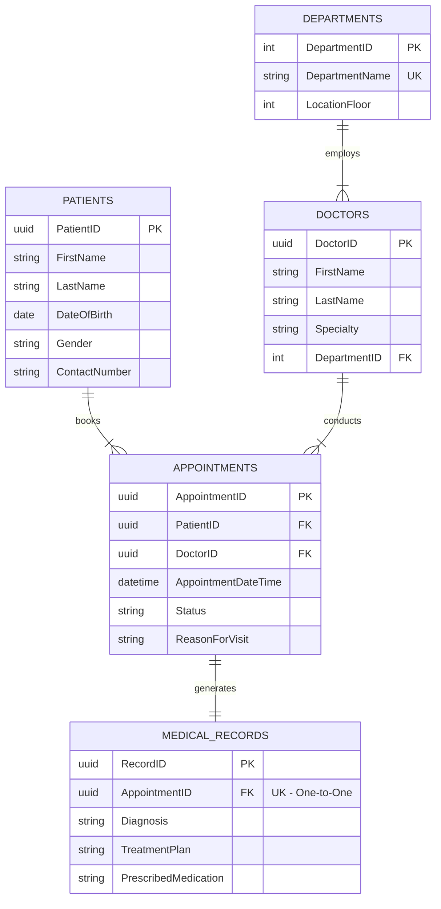

# Entity-Relationship Diagram: Hospital Management System

This diagram visualizes the relational schema designed in `01_schema_normalized.sql`. It illustrates the entities, their attributes, and the cardinalities of their relationships, adhering to 3NF/BCNF normalization standards.

## Relationship Details
*   **One-to-Many (1:N):** One Department can have many Doctors.
*   **One-to-Many (1:N):** One Patient can have many Appointments over time.
*   **One-to-Many (1:N):** One Doctor conducts many Appointments.
*   **One-to-One (1:1):** One completed Appointment generates exactly one Medical Record. (This isolates diagnosis data from the scheduling data, preserving BCNF).
